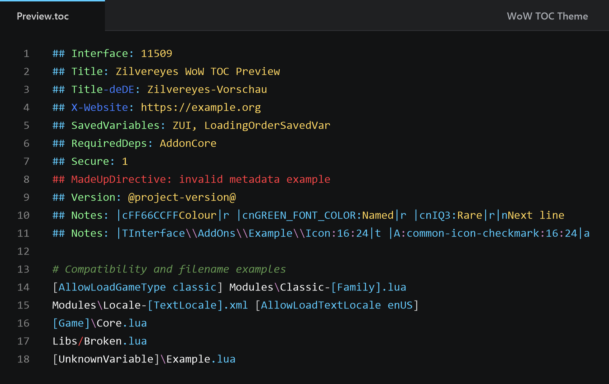

# vscode-wow-toc for VS Code

[](http://opensource.org/licenses/MIT)
[](https://github.com/Stanzilla/vscode-wow-toc/releases)

This World of Warcraft addon developer toolset for VS Code includes a .toc file grammar and colorization.

## Features

* `.toc` file colorization
* starting point snippet

### Grammars

#### > Toc files

Also included is a simple grammar for `.toc` files with support for keywords (like `## Interface`, `## Author` and such) and X-keywords (like `## X-Date`, `## X-Website` and such)



## Zilvereyes recovery preview

Run `.\Open-Preview.ps1` from this worktree. It opens `Preview.toc` with **WoW TOC Theme** in a fresh VS Code profile with its own extensions directory. Each preview uses a temporary, separate user profile.

- `npm ci --ignore-scripts` followed by `npm test` checks the grammar with TextMate and Oniguruma, including token colors.
- `.\Open-Preview.ps1 -Verify` checks extension discovery, theme selection and TOC language detection in VS Code.
- Use **Developer: Inspect Editor Tokens and Scopes** in the preview to verify the color and scope of an individual token.

The grammar starts from the recovered VS Code snapshot `RsU4.json` from 15 June 2026. Conditional and file variable rules come from the earlier `toc.tmLanguage.json` download and have separate scopes inside file entries. The reconstructed theme uses the 17 TOC rules in the historical settings snapshot `XfkR.json`, mapped to the merged grammar’s scopes. The backup also contains the earlier theme palette in `Rl5B.json`. These tests cover editor highlighting. The game client interprets directives according to its build.
## XML file reference warnings

Set these workspace settings for the add-on you are editing:

```json
{
  "zilvereyes.wowToc.xmlReferenceManifest": "MyAddon.toc",
  "zilvereyes.wowToc.xmlReferenceClient": "classic-era",
  "zilvereyes.wowToc.xmlReferenceTextLocale": "enUS"
}
```

The manifest is explicit. Select `classic-era` for Classic Era (Vanilla) or `retail` for Retail (Standard). The settings picker also lists the supported Classic expansions. Set the optional text locale when the add-on uses locale restrictions or `[TextLocale]`.

The check reads the TOC through the SDK, applies `AllowLoadGameType` and `ExcludeLoadGameType` on the manifest and its file lines, and supports inline `AllowLoadTextLocale` and `AllowLoad` for the in-game editor context. It expands `[Family]`, `[Game]` and `[TextLocale]` in TOC XML paths. Unknown client or locale conditions, unsupported conditions and unresolved variables suppress diagnostics for their affected entries. The XML walk follows `Include` recursively and resolves literal `Include` and `Script` paths from the referring XML file. Missing XML selected by the TOC is reported on its TOC line. A missing XML reference target is marked on the value of the referring XML `file` attribute. The Problems panel refreshes on client changes and when relevant files are created, removed or saved. The [TOC format reference](https://warcraft.wiki.gg/wiki/TOC_format) describes the loading directives and file variables.

### SDK dependency

[`sdk-source.json`](sdk-source.json) pins the source revision of [wow-addon-sdk](https://github.com/Zilvereyes/wow-addon-sdk). On either laptop, check out and build that SDK revision, then bundle its public TOC, XML and SavedVariables APIs into the extension. The SDK owns parsing and source ranges. The extension supplies the client selection, file checks and VS Code diagnostics. See the SDK's [editor consumer contract](https://github.com/Zilvereyes/wow-addon-sdk/blob/151c5e959fada20703a32cb3bc556102cdd31166/docs/EDITOR-CONSUMERS.md) for the API responsibilities.

```powershell
git clone https://github.com/Zilvereyes/wow-addon-sdk.git
git -C wow-addon-sdk switch --detach 7b01bd0511fbe651d1234848f73140c9d012c2a9
npm --prefix wow-addon-sdk ci
npm --prefix wow-addon-sdk run build

# From the extension checkout with the SDK next to it:
npm ci
npm run build:sdk -- ../wow-addon-sdk
npm test
```

LuaLS SavedVariables sync uses its own setting, `zilvereyes.wowToc.savedVariablesManifest`.

